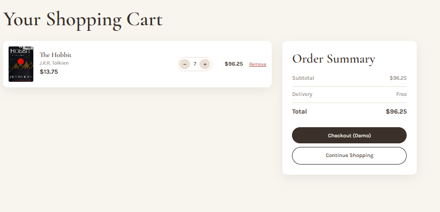

# Book Haven – Online Bookstore

CSCI426 – Advanced Web Programming · Project Phase 1

Book Haven is a frontend React application for an elegant online bookstore. Users can browse books, search, filter by category, sort by price, view book details and manage a shopping cart that is saved in localStorage.

## Main Features
- Six pages with React Router: Home, About, Shop, Contact, Book Details (`/book/:id`), Cart
- Search books by title or author
- Filter by category and sort by price (map, filter, sort)
- Dynamic book details page
- Shopping cart: add, remove, increase/decrease quantity, automatic total
- Cart counter in the Navbar
- Cart saved in localStorage (survives page refresh)
- Contact form with validation and success message
- Responsive design (desktop, laptop, tablet, mobile)

## Technologies Used
- ReactJS (functional components, props, useState, useEffect)
- JavaScript ES6+
- Vite
- React Router DOM
- HTML / JSX
- CSS3 (plain CSS)

## Installation
Requirements: Node.js (LTS) from https://nodejs.org and VS Code.

```bash
cd book-haven
npm install
```

## Run the Application
```bash
npm run dev
```
Open http://localhost:5173 in your browser.

Build for production:
```bash
npm run build
npm run preview
```

## Project Structure
```
book-haven/
├── public/
│   ├── _redirects
│   └── images/
│       ├── hero.jpg
│       └── about.jpg
├── src/
│   ├── components/  Navbar.jsx, Footer.jsx, BookCard.jsx, CartItem.jsx
│   ├── pages/       Home.jsx, About.jsx, Shop.jsx, Contact.jsx, BookDetails.jsx, Cart.jsx, NotFound.jsx
│   ├── data/        books.js
│   ├── App.jsx
│   ├── main.jsx
│   └── style.css
├── index.html
├── vite.config.js
├── vercel.json
├── package.json
└── README.md
```

## Git & GitHub
```bash
git init
git add .
git commit -m "Initial commit: Book Haven"
git branch -M main
git remote add origin https://github.com/<your-username>/book-haven.git
git push -u origin main
```

## Deployment
- **Vercel:** import the GitHub repo, framework "Vite", build `npm run build`, output `dist`. `vercel.json` makes page refresh work on all routes.
- **Netlify:** build `npm run build`, publish directory `dist`. `public/_redirects` handles routes.
- **GitHub Pages:** set `base: "/book-haven/"` in `vite.config.js`, build, and publish the `dist` folder (e.g. with the `gh-pages` package).

## Screenshots

### Home Page
[](./screenshots/home.png)

### Shop Page
[](./screenshots/shop.png)

### Book Details
[](./screenshots/details.png)

### Shopping Cart
[](./screenshots/cart.png)

### Contact Page
[](./screenshots/contact.png)

## Note
Book covers are loaded from the free Open Library Covers service, so an internet connection is needed to see them.
